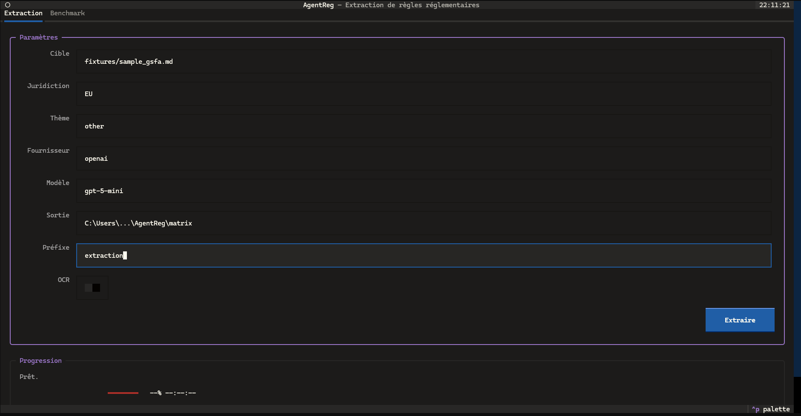

# AgentReg

Extraction of food safety rules from raw regulatory texts into a filterable, citable matrix.

<p align="center">
  
</p>

The project delivers five outputs:
- a reference **schema** for representing a regulatory rule (`src/schema.py`);
- a PDF/DOCX/Markdown -> LLM-structured rules **pipeline**, with monitoring and resumption;
- a consolidated CSV/JSON **matrix** with provenance (`matrix/`);
- a **benchmark** for measuring precision, recall, F1, omissions and hallucinations (`benchmark/`);
- a **CLI and a Textual UI** for running an extraction on a file, a folder or a country.

## Requirements

A single tool: [uv](https://docs.astral.sh/uv/). Python 3.11+ is resolved and installed automatically by uv, so there is nothing else to set up.

## Installation

```bash
uv sync
cp .env.example .env
```

Then fill in the API key in `.env`. The **default** provider is `openai` with the `gpt-5-mini` model (defined once, in `src/llm.py`): **`OPENAI_API_KEY` is enough** to run all the examples in this README as-is.

Four providers are available (`src/llm.py`, one entry each); to switch, add two options to any command:

```bash
uv run agentreg run ... --provider claude --model claude-sonnet-4-6        # official Anthropic API
uv run agentreg run ... --provider openrouter --model anthropic/claude-sonnet-4.6
uv run agentreg run ... --provider ollama --model glm-5.2:cloud            # open-source models
```

(each provider reads its own key from `.env`: `ANTHROPIC_API_KEY`, `OPENROUTER_API_KEY`, `OLLAMA_API_KEY` — see `.env.example`).

## CLI usage

The central requirement of the assignment — "the country becomes the argument" — is run as follows:

```bash
uv run agentreg run --country India
```

This command recursively processes `source/reglementations/India/`, fills in `jurisdiction=India` and writes `matrix/india.csv` + `matrix/india.json`. No other argument is needed.

Extract a single file:

```bash
uv run agentreg run fixtures/sample_gsfa.md --jurisdiction Codex --theme food_additives --stem sample
```

List the files that would be processed, without calling the LLM:

```bash
uv run agentreg run --country India --dry-run
```

Outputs are written to `matrix/` by default:
- `<stem>.csv`: flat, filterable view;
- `<stem>.json`: complete records with provenance.

Available options:

| Option | Purpose |
| --- | --- |
| `--country <pays>` | The country becomes the argument: folder, jurisdiction and output name derived from the country. Mutually exclusive with positional targets. |
| `--jurisdiction` | Country / jurisdiction (e.g. EU, Codex, India). Required without `--country`. |
| `--theme` | Theme passed to the prompt (default: `other`). |
| `--document-ref` | Document reference, only for a single target. |
| `--recursive` | Traverse folders recursively. |
| `--ocr` | Enable Docling OCR for scanned PDFs (slower). |
| `--fast` | Fast PDF reading path (pymupdf4llm, about 10x faster than Docling). |
| `--out` | Output folder (default: `matrix/`). |
| `--stem` | Prefix for the CSV/JSON files (default: `extraction`, or the country with `--country`). |
| `--provider` | LLM provider: `openai` (default), `claude`, `openrouter`, `ollama`. |
| `--model` | Model at the provider (default: `gpt-5-mini`). |
| `--dry-run` | List the targets without calling the LLM. |

Under Git Bash, use `/` in paths (`fixtures/sample_gsfa.md`). The CLI also tolerates some Windows paths with `\` that are mis-interpreted by the shell.

## Monitoring and resumption

Each document is identified by a fingerprint of its **content**, stored in `matrix/checkpoints.sqlite`. Practical consequences:

- re-running the same command **skips** unchanged documents (no reading, no LLM call) and only reprocesses what has changed;
- an **interrupted** run (outage, Ctrl+C) resumes where it left off;
- deleting `matrix/checkpoints.sqlite` forces a full reprocessing.

The complete strategy (per-page fingerprint, scheduled re-runs) is future work.

## Textual interface

```bash
uv run agentreg ui
```

Or with a pre-filled target:

```bash
uv run agentreg ui fixtures/sample_gsfa.md
```

The interface has two tabs: **Extraction** (choice of file or folder, OCR toggle, live log) and **Benchmark** (run the synthetic cases and read the scores).

## Tests

```bash
uv run pytest -q
```

88 tests, all offline: they use a fake LLM, so no API key or network is needed.

## Reproducing the deliverables

The consolidated matrix (`matrix/matrix.csv` + `matrix/matrix.json`):

```bash
uv run python -m matrix.build
```

Test mode on a single document (writes to `matrix.test.*` so as not to overwrite the real matrix):

```bash
uv run python -m matrix.build "GMP additives"
```

The benchmark (scores for one model, then a models × cases matrix):

```bash
uv run python benchmark/run.py
uv run python benchmark/run.py --compare
```

Regenerate the benchmark's synthetic datasets:

```bash
uv run python benchmark/generate.py
```

## Structure

The code lives under `src/` (the import root): four top-level modules plus four role-based subpackages.

- `src/schema.py`: reference `Rule` model (Pydantic).
- `src/llm.py`: all LLM calls go through here; the project's provider/model defaults.
- `src/prompts.py`: all the texts sent to the LLM, grouped together for easy review.
- `src/logs.py`: shared colored logging (Rich).
- `src/pipeline/`: document -> rules.
  - `parser.py`: document -> Markdown (Docling by default, fast pymupdf4llm path with `--fast`).
  - `chunker.py`: adaptive splitting into chunks.
  - `structurer.py`: LLM-structured extraction, notes glossary (built chunk by chunk), deduplication.
- `src/orchestration/`: LangGraph engines.
  - `doc_workflow.py`: document-level engine — reading, splitting, extraction.
  - `corpus.py`: corpus-level engine — chains documents, carries monitoring and resumption.
- `src/matrix/`: the consolidated matrix.
  - `io.py`: contract for the 17 CSV/JSON columns.
  - `build.py`: produces `matrix/matrix.csv` + `matrix.json` (run with `python -m matrix.build`).
- `src/cli/`: user entry points.
  - `app.py`: the `agentreg` command (`run` and `ui` subcommands).
  - `ui.py`: Textual interface.
- `benchmark/`: synthetic datasets, metrics and model comparison.
- `matrix/`: produced matrices, monitoring checkpoint and column documentation.
- `fixtures/`: small example documents for trying out the CLI.
- `source/`: raw regulatory corpus, organized by country under `source/reglementations/`.

## Known limitations

- **Large documents**: the two largest in the corpus (Codex CXS 192, 568 pages; EU Regulation 1333/2008) are excluded from the delivered matrix as a matter of **cost** per run, not of technique — the notes glossary is now built chunk by chunk, which removes the former blocker.
- **Scanned Thai documents**: OCR-based reading exists (`--ocr`), but the full batch has not been run.
- **Monitoring**: the document level is implemented (see "Monitoring and resumption"); the per-page fingerprint and the re-run scheduler remain to be done.

## References

**Libraries**
- [Docling](https://github.com/docling-project/docling) — the document-parsing engine behind `src/pipeline/parser.py` (PDF/DOCX → Markdown, with table-structure recovery and OCR).
- [LangGraph](https://langchain-ai.github.io/langgraph/) — pipeline orchestration and durable checkpoints (`src/orchestration/`).
- [Pydantic](https://docs.pydantic.dev/) — the `Rule` schema and structured LLM output (`src/schema.py`).
- [Textual](https://textual.textualize.io/) — the terminal UI (`src/cli/ui.py`).

**Research**
- Brandon Smith & Anton Troynikov, [*Evaluating Chunking Strategies for Retrieval*](https://www.trychroma.com/research/evaluating-chunking) (Chroma, 2024) — motivates the adaptive, semantic chunking in `src/pipeline/chunker.py`: chunk boundaries measurably affect downstream quality, and cluster/LLM-based semantic chunkers are competitive with well-tuned heuristics.
- Additional evaluation-design sources (entity-matching metrics, embeddings vs. numbers) are listed in [`benchmark/README.md`](benchmark/README.md).